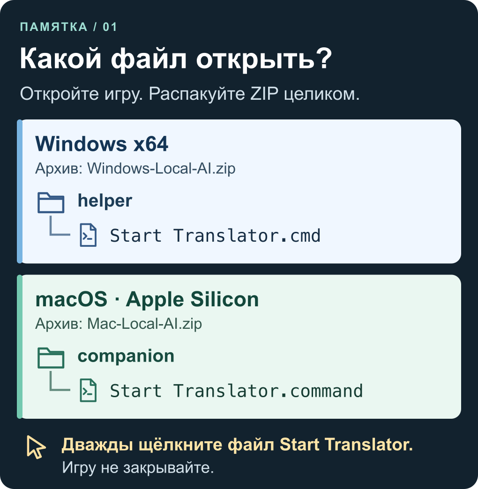
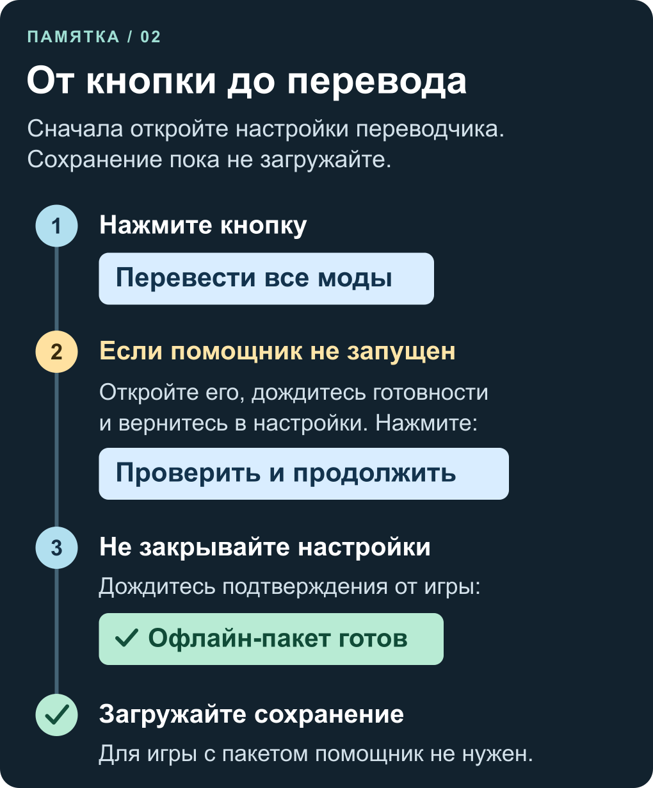

# Probably Stolen: translate mods into Russian

[Русский](README.md) · **English** · [Release 0.4.12](https://github.com/sadesguy/probably-stolen-translator/releases/tag/v0.4.12)

**Here from the game?** Leave the settings window open and [choose the Windows or Mac helper](#helper).

This community mod prepares Russian translations **before you open a save**. Once you have a saved translation pack, play without the AI helper or an internet connection. You only need the helper to generate or update a pack on your own computer.

## 1. Install the game mod

1. Close *Probably Stolen*. In Steam, open the game's **Manage → Browse local files**.
2. Download [Workshop-Mod.zip](https://github.com/sadesguy/probably-stolen-translator/releases/download/v0.4.12/Workshop-Mod.zip). Despite the filename, this is the **manual installation**. Create a folder named `LocalModTranslator` inside the game's `Mods` folder. Put the two extracted files in it:
   ```text
   Mods/LocalModTranslator/
   ├── manifest.xml
   └── LocalModTranslator.dll
   ```
3. Start the game. In **Mods** (`Моды`), select **Локальный переводчик модов** and activate it. The mod asks for network access to reach your local helper and permission to open this guide in your browser. If upgrading from [0.4.11](https://github.com/sadesguy/probably-stolen-translator/releases/tag/v0.4.11), select **Review and enable** to approve the new browser-link permission. Enable the mods you want translated, restart the game and select **Русский** as the game language. [How the game handles permissions and updates.](https://github.com/dragonpan2/probably-stolen-modding/blob/main/ModdingGuide.md#what-players-see)
4. In the main menu, open the translator's **settings**. If a matching offline pack is already installed, load your save and play. Otherwise click **Перевести все моды** (“Translate all mods”). If the helper isn't running, click **Открыть инструкцию на GitHub** (“Open the guide on GitHub”). If no browser appears, open `https://sadesguy.github.io/probably-stolen-translator/en.html#helper` in your browser. **Leave the settings window open.**

If you install a future Workshop release instead, subscribe, let Steam finish downloading, then follow step 3. Don't install both versions: the local copy takes priority. See the [game developer's activation guide](https://github.com/dragonpan2/probably-stolen-modding/blob/main/ModdingGuide.md#steam-workshop).

<a id="helper" name="helper"></a>

## 2. Start the local AI helper

Download **one** file for your computer. Extract the **entire** archive to your own folder **outside Steam**. Do not put the helper in `Mods` or run it from the ZIP preview. The [game's scanner rules](https://github.com/dragonpan2/probably-stolen-modding/blob/main/ModdingGuide.md#capabilities-and-the-scanner) are why the launcher is separate.

| Computer | Get this ZIP | Double-click after extraction |
| --- | --- | --- |
| Windows 10/11 x64, Intel or AMD | [Windows-Local-AI.zip](https://github.com/sadesguy/probably-stolen-translator/releases/download/v0.4.12/Windows-Local-AI.zip) | `helper/Start Translator.cmd` |
| Apple Silicon Mac running the Steam game through Wine | [Mac-Local-AI.zip](https://github.com/sadesguy/probably-stolen-translator/releases/download/v0.4.12/Mac-Local-AI.zip) | `companion/Start Translator.command` in **Finder**, not Wine |



- **Windows:** Use a local NTFS drive. The helper includes Python. It needs a physical Vulkan-capable GPU, its driver, and the [Microsoft Visual C++ v14 x64 runtime](https://learn.microsoft.com/en-us/cpp/windows/latest-supported-vc-redist).
- **Mac:** The helper uses Metal and needs native ARM64 Python 3.9 or newer. If missing, use the [Python.org macOS installer](https://www.python.org/downloads/macos/). Intel Macs and Rosetta Python are not supported.
- **First run:** Allow about **6 GB of free disk space**, plus enough GPU memory for the model. The helper asks before downloading about **5.2 GB**: [Google's Gemma model](https://huggingface.co/google/gemma-4-E4B-it-qat-q4_0-gguf) and the [llama.cpp engine](https://github.com/ggml-org/llama.cpp/releases/tag/b12477). No need to install them manually. Your dialogue is processed locally, never sent to a cloud translator. To check your ZIP, compare its SHA-256 against the [release checksums](https://github.com/sadesguy/probably-stolen-translator/releases/download/v0.4.12/SHA256SUMS.txt).

### If your Mac says “Start Translator.command” Not Opened

If Apple says it **could not verify** the file, click **Done**. The launcher is unsigned and has not been notarized by Apple. If macOS instead says the file **contains malware**, is damaged or will damage your computer, **do not run it**.

If you downloaded the ZIP from this release, open Terminal and run `shasum -a 256 ~/Downloads/Mac-Local-AI.zip`. Compare the result with the `Mac-Local-AI.zip` line in the [0.4.12 checksums](https://github.com/sadesguy/probably-stolen-translator/releases/download/v0.4.12/SHA256SUMS.txt). Stop if they differ.

Only if you trust the source and the checksum matches: go to **System Settings → Privacy & Security**, find the warning for `Start Translator.command`, click **Open Anyway**, then **Open**. This makes an exception for that file only; don't disable Gatekeeper. [Apple’s walkthrough with screenshots](https://support.apple.com/en-us/102445).

## 3. Prepare, then play offline

1. Keep the helper window open. Wait for **Ready** on Windows, or **GPU MTL0: … model layers offloaded** on Mac.
2. Return to the mod settings. Click **Проверить и продолжить** (“Check and continue”) if the instructions are showing; otherwise click **Перевести все моды**. This scans installed mods for missing or suspect translations. **Проверить все диалоги** (“Review all dialogue”) is optional and slower.
3. Keep the settings open until **Офлайн-пакет готов** (“Offline pack ready”) appears. This confirms the game saved the pack. Now load your save. After adding or updating mods, repeat preparation to refresh it.



Quitting the game stops the helper and unloads the model from memory. Model files stay on disk for next time. If you quit during preparation, reopen the game, start the helper again and repeat step 3. Completed rows in the helper cache are reused.

### If something doesn't work

- **The mod is missing:** Check the two-file layout above. An extra enclosing folder, an unextracted ZIP or the helper in place of the mod won't work. Restart after activation.
- **The game can't find the helper:** Open the game first, then use the exact launcher for your platform. Wait for the ready message, then click **Проверить и продолжить**. Do not disable SmartScreen or Gatekeeper to run a blocked download.
- **GPU check failed:** Check the GPU driver and available GPU memory; Windows also needs the x64 runtime above. No CPU or cloud fallback is used.
- **A line stays untranslated:** The mod reads supported localization tables, not lettering baked into images or every custom interface. It may skip text it can't translate reliably. For dialogue, try the optional full review.
- **“0 строк для офлайн-перевода” instead of “ready”:** No rows were saved to the new pack. Existing Russian text still works. Check that the mods you expected to translate have finished downloading and contain supported text tables.
