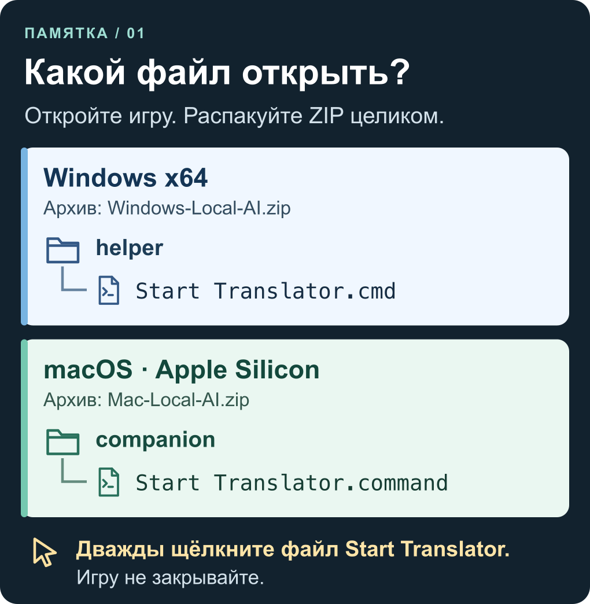
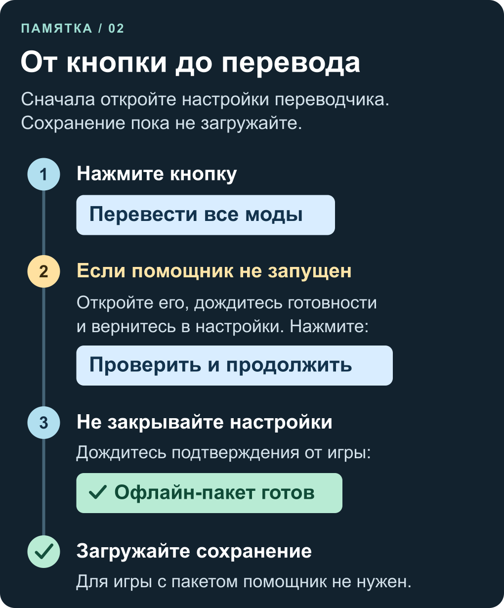

# Probably Stolen: перевод модов на русский

**Русский** · [English guide](GUIDE.en.md) · [Все файлы версии 0.4.12.2](https://github.com/sadesguy/probably-stolen-translator/releases/tag/v0.4.12.2)

**Открыли страницу из игры?** Не закрывайте настройки. [Выберите помощник для Windows или Mac](#helper).

Переводчик готовит русский текст **до загрузки сохранения**. Помощник с локальным ИИ нужен, только если вы хотите создать или обновить перевод. Если совместимый русский пакет уже установлен, можно сразу играть: сервер, модель и интернет для чтения пакета не нужны.

Это неофициальный мод сообщества для [Probably Stolen](https://store.steampowered.com/app/4348910/Probably_Stolen/). Установка — из GitHub, не из Мастерской Steam. В выпуске 0.4.12.2 исправлена только загрузка модели на Mac. Если у вас уже стоит мод или помощник Windows версии 0.4.12, переустанавливать их не нужно.

## 1. Установите мод и включите его в игре

1. Закройте игру. В библиотеке Steam нажмите правой кнопкой на **Probably Stolen → Управление → Просмотреть локальные файлы**.
2. Скачайте **[Workshop-Mod.zip](https://github.com/sadesguy/probably-stolen-translator/releases/download/v0.4.12.2/Workshop-Mod.zip)**. В каталоге игры создайте папку `Mods/LocalModTranslator`. Положите в неё **два файла из архива**, не сам ZIP. Проверьте, что между папкой мода и файлами нет ещё одной вложенной папки:
   ```text
   Probably Stolen/
   └── Mods/
       └── LocalModTranslator/
           ├── manifest.xml
           └── LocalModTranslator.dll
   ```
3. Откройте **Моды → Локальный переводчик модов** и активируйте его. Игра запросит два разрешения: сеть для связи с помощником на вашем компьютере и открытие ссылок в браузере для этой инструкции. Если обновляетесь с [0.4.11](https://github.com/sadesguy/probably-stolen-translator/releases/tag/v0.4.11), проверьте разрешения и подтвердите активацию заново: добавилось разрешение на открытие ссылок. Включите нужные моды, перезапустите игру и выберите **русский язык**. [Правила активации и обновления модов.](https://github.com/dragonpan2/probably-stolen-modding/blob/main/ModdingGuide.md#what-players-see)
4. В главном меню откройте **Моды → Локальный переводчик модов → Настройки → Перевести все моды**. Если игра не найдёт помощник, нажмите **«Открыть инструкцию на GitHub»**. Если браузер не появился, откройте в нём `https://sadesguy.github.io/probably-stolen-translator/#helper`. **Оставьте настройки открытыми.**

<a id="helper" name="helper"></a>

## 2. Скачайте один помощник и дважды нажмите нужный файл

| Ваш компьютер | Что скачать | Что открыть после распаковки |
|---|---|---|
| Windows 10/11 x64 (Intel или AMD), видеокарта с Vulkan | [Windows-Local-AI.zip](https://github.com/sadesguy/probably-stolen-translator/releases/download/v0.4.12.2/Windows-Local-AI.zip) | Папка `helper` → **`Start Translator.cmd`** |
| Mac с Apple Silicon и игрой Steam, запущенной через Wine | [Mac-Local-AI.zip](https://github.com/sadesguy/probably-stolen-translator/releases/download/v0.4.12.2/Mac-Local-AI.zip) | В **Finder**: папка `companion` → **`Start Translator.command`** |

**Распакуйте архив целиком** в свою папку вне Steam. В Windows выберите «Извлечь всё…», а не запускайте файл прямо из окна ZIP. На Mac откройте архив двойным щелчком. Не копируйте помощник в `Mods`: [сканер игры не допускает там такие программы и скрипты](https://github.com/dragonpan2/probably-stolen-modding/blob/main/ModdingGuide.md#capabilities-and-the-scanner).



- **Windows:** распакуйте на локальный диск NTFS. Python уже в комплекте. Нужны драйвер Vulkan и [Microsoft Visual C++ v14 x64](https://learn.microsoft.com/en-us/cpp/windows/latest-supported-vc-redist). Если они отсутствуют, помощник сообщит об этом. Он не меняет системные настройки.
- **Mac:** помощник работает на Metal; нужен Python 3.9 или новее **для Apple Silicon**, не через Rosetta. Если его нет, используйте [установщик с python.org](https://www.python.org/downloads/macos/). Запускайте помощник в macOS, не внутри Wine.
- **Первый запуск:** оставьте не менее **6 ГБ свободного места**. Помощник спросит, можно ли скачать около **5,2 ГБ**: [модель Gemma от Google](https://huggingface.co/google/gemma-4-E4B-it-qat-q4_0-gguf) и [движок llama.cpp](https://github.com/ggml-org/llama.cpp/releases/tag/b12477). Вручную скачивать их не нужно. Видеопамяти должно хватать для всей модели; запасного режима на CPU или в облаке нет. Текст диалогов обрабатывается на вашем компьютере.

**На Mac появилась ошибка `HTTPError` или `untrusted_download_redirect` при загрузке Gemma?** Скачайте новый [Mac-Local-AI.zip](https://github.com/sadesguy/probably-stolen-translator/releases/download/v0.4.12.2/Mac-Local-AI.zip) и распакуйте в отдельную папку. Не закрывая игру, дважды нажмите `companion/Start Translator.command` **из новой папки**. Если движок llama.cpp уже скачан и прошёл проверку, помощник предложит скачать только модель.

Теперь при ошибке HTTP помощник показывает код и имя сервера. Если сервер временно недоступен до начала передачи файла, помощник может повторить запрос. Если видите время до следующей попытки, дождитесь её, не закрывая окно. Если загрузка так и не началась, сообщите только код и имя сервера (например, `HTTP 429`, `huggingface.co`), а не полную ссылку.

### Если Mac не открыл Start Translator.command

Если Apple сообщает, что **не может проверить** файл, нажмите **«Готово» (Done)**. Этот скрипт не подписан и не прошёл проверку Apple (notarization). Если же macOS сообщает о **вредоносном ПО**, повреждении файла или о том, что он повредит компьютеру, **не запускайте его**.

Если скачали архив по ссылке из этого релиза, проверьте его в Терминале: `shasum -a 256 ~/Downloads/Mac-Local-AI.zip`. Сравните результат со строкой `Mac-Local-AI.zip` в [контрольных суммах 0.4.12.2](https://github.com/sadesguy/probably-stolen-translator/releases/download/v0.4.12.2/SHA256SUMS.txt). Если суммы различаются, не продолжайте.

Только если вы доверяете источнику и суммы совпали, откройте **Системные настройки → Конфиденциальность и безопасность**. Найдите предупреждение именно для `Start Translator.command`, нажмите **Open Anyway**, затем **Открыть**. Это исключение только для этого файла. Не отключайте Gatekeeper. [Инструкция Apple со снимками экрана](https://support.apple.com/en-us/102445).

## 3. Дождитесь записи пакета и откройте сохранение

1. Дождитесь **Ready** в окне Windows или строки **GPU MTL0: … model layers offloaded** на Mac. Не закрывайте это окно.
2. Вернитесь в настройки мода. Если перед вами инструкция, нажмите **«Проверить и продолжить»**. Иначе нажмите **«Перевести все моды»**. Основная кнопка проверяет пропуски и сомнительные строки. **«Проверить все диалоги»** — отдельная, более долгая проверка; для обычной подготовки она не нужна.
3. **Не закрывайте настройки до сообщения «Офлайн-пакет готов».** Оно означает, что перевод сохранён игрой, а не просто сгенерирован помощником. Теперь можно закрыть помощник и открыть сохранение. В следующий раз его запускать не надо.



При выходе из игры помощник завершает работу и выгружает модель из памяти. Файлы модели остаются **на диске** для следующей подготовки. Если установили новый мод, обновили старый или прервали подготовку, снова откройте игру, запустите уже распакованный помощник и повторите шаг 3. Уже обработанные неизменившиеся строки берутся из кэша.

### Если что-то пошло не так

| Что вы видите | Что делать |
|---|---|
| Переводчика нет в меню | Сверьте расположение двух файлов с деревом в шаге 1. Нужна распакованная папка, а после активации — перезапуск игры. |
| «Не удалось подключиться к локальному помощнику» | Сначала запустите игру, затем нужный `Start Translator` из распакованной папки. Дождитесь готовности и нажмите «Проверить и продолжить». Не отключайте SmartScreen, Gatekeeper или антивирус. |
| Модель не загрузилась на GPU | Проверьте драйвер и свободную видеопамять. В Windows проверьте также Visual C++ x64. Наличие Vulkan само по себе не гарантирует, что модель поместится. |
| «0 строк для офлайн-перевода» | В новый пакет не записано ни одной строки. Убедитесь, что нужные моды скачаны и содержат таблицы локализации. Уже имеющийся русский текст не требует нового пакета. |
| Одна фраза на другом языке или с ошибкой | Если это диалог, попробуйте полную проверку. Переводчик может пропускать неоднозначные строки. Надписи на картинках и текст, который другой мод рисует самостоятельно, могут быть недоступны. |

**Проверить загрузки:** [SHA256SUMS.txt для трёх архивов](https://github.com/sadesguy/probably-stolen-translator/releases/download/v0.4.12.2/SHA256SUMS.txt). [Лицензии и компоненты помощника Windows](notices/Windows-components.txt). В релизе нет модели, сохранений или переводов чужих модов.
